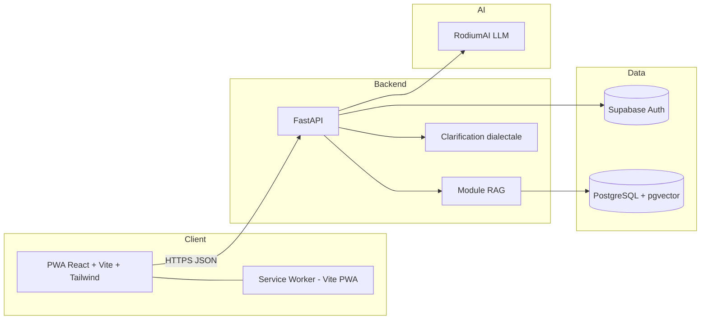

# EduDialect AI

> **Français** | [English](#english)

---

## Français

### 1. Vision du projet

EduDialect AI est une Progressive Web App (PWA) d'accompagnement scolaire conçue pour les élèves de Seconde et Première au lycée, à Sokodé (Togo). Le projet vise à rendre l'aide aux études accessible, dans la langue et le contexte des élèves : questions-réponses fondées sur les programmes, clarification des notions dans les dialectes locaux, et accès à des ressources pédagogiques vérifiées.

Objectifs principaux :
- Démocratiser le soutien scolaire personnalisé, même avec une connexion limitée.
- Réduire les incompréhensions liées à la langue en proposant des explications contextualisées.
- S'appuyer sur des ressources pédagogiques réelles (RAG) pour limiter les réponses hors programme.

### 2. Public cible

- Élèves de **Seconde** et **Première** (lycée) à **Sokodé**, Togo.
- Enseignants et parents souhaitant suivre la progression des élèves (fonctionnalités futures).
- Utilisateurs disposant principalement d'un smartphone, avec une connexion intermittente.

### 3. Spécifications fonctionnelles

| Module | Description |
|---|---|
| **PWA** | Application installable, fonctionnement hors ligne partiel (cache des ressources, file d'attente des questions), mises à jour automatiques via Vite PWA. |
| **Espace élève** | Tableau de bord personnel, historique des questions, notes de cours, favoris, suivi des matières. |
| **Q&A avec RodiumAI** | Questions en français, réponses générées par le LLM RodiumAI, avec explications pas à pas et exemples adaptés au programme. |
| **Clarification dialectale locale** | Reformulation des questions et réponses lorsque l'élève utilise un terme local ou un dialecte ; glossaire évolutif des équivalents. |
| **RAG pédagogique** | Recherche sémantique dans des supports de cours (chapitres, exercices corrigés) indexés dans pgvector, afin d'ancrer les réponses dans les sources. |
| **Sources et citations** | Chaque réponse RAG affiche les extraits de référence utilisés. |

### 4. Architecture

#### 4.1 Flux Client-Serveur

```
+-----------------+        HTTPS / JSON        +------------------+
|  PWA (React)    | -------------------------> |  API FastAPI     |
|  Vite + Tailwind|                            |  (Python)        |
|  Service Worker | <------------------------- |                  |
+-----------------+        Réponses / SSE     +--------+---------+
                                                        |
                                   +--------------------+-------------------+
                                   |                                        |
                           +-------v--------+                     +---------v---------+
                           | Supabase       |                     | RodiumAI (LLM)    |
                           | Auth + Postgres|                     | Génération de      |
                           | + pgvector     |                     | réponses           |
                           +----------------+                     +-------------------+
```

Étapes typiques d'une question :
1. L'élève envoie sa question depuis la PWA (JWT Supabase).
2. FastAPI valide le token, enregistre la question et récupère le contexte RAG.
3. FastAPI appelle RodiumAI avec le prompt enrichi (contexte + règles de clarification dialectale).
4. La réponse est renvoyée au client, sauvegardée dans l'historique et mise en cache pour le hors-ligne.

#### 4.2 Pipeline RAG (pgvector / Supabase & RodiumAI)

```
  Documents pédagogiques (PDF, MD, fiches)
                 |
                 v
  +-----------------------------+
  | 1. Extraction & nettoyage   |
  +-----------------------------+
                 |
                 v
  +-----------------------------+
  | 2. Découpage en chunks      |
  |    (chevauchement ~10%)     |
  +-----------------------------+
                 |
                 v
  +-----------------------------+
  | 3. Embeddings (RodiumAI)    |
  +-----------------------------+
                 |
                 v
  +-----------------------------+
  | 4. Stockage Supabase        |
  |    table documents          |
  |    colonne embedding        |
  |    vector (pgvector, HNSW)  |
  +-----------------------------+

  ---------------- Requête élève ----------------

  Question --> Embedding --> Recherche cosinus top-k (pgvector)
                                  |
                                  v
                  Contexte filtré (matière, niveau, classe)
                                  |
                                  v
                  Prompt = instructions + contexte + question
                                  |
                                  v
                  RodiumAI --> Réponse + citations des sources
```

#### 4.3 Architecture système



### 5. Stack technique

| Couche | Technologie |
|---|---|
| Frontend | React, Vite, Tailwind CSS |
| PWA | Vite PWA plugin (manifest, service worker, cache hors-ligne) |
| Backend | FastAPI (Python) |
| Base de données | Supabase / PostgreSQL |
| Recherche vectorielle | pgvector |
| Authentification | Supabase Auth |
| LLM | RodiumAI |

### 6. Feuille de route MVP

- **Phase 0 : Fondations** : dépôt, CI de base, structure frontend/backend, schéma Supabase.
- **Phase 1 : PWA et espace élève** : authentification, profil (classe, matières), tableau de bord, installation PWA.
- **Phase 2 : Q&A RodiumAI** : envoi de questions, réponses générées, historique.
- **Phase 3 : RAG pédagogique** : ingestion de 2 à 3 matières (Maths, Physique-Chimie, SVT ou Français), recherche pgvector, citations.
- **Phase 4 : Clarification dialectale** : glossaire initial et règles de reformulation, validation avec des enseignants de Sokodé.
- **Phase 5 : Pilote** : test auprès d'un petit groupe d'élèves, collecte de retours, correction des priorités.

### 7. Guide d'installation

#### Prérequis
- Node.js 20+ et npm
- Python 3.11+
- Un projet Supabase (avec l'extension `vector` activée)
- Une clé API RodiumAI

#### Installation
```bash
git clone https://github.com/justin2119/edudialect-ai.git
cd edudialect-ai

# Frontend
cd frontend
npm install
cp .env.example .env.local   # renseigner VITE_SUPABASE_URL, VITE_SUPABASE_ANON_KEY, VITE_API_URL
npm run dev

# Backend (dans un autre terminal)
cd ../backend
python -m venv .venv
source .venv/bin/activate     # Windows : .venv\Scripts\activate
pip install -r requirements.txt
cp .env.example .env         # renseigner SUPABASE_DB_URL, RODIUM_API_KEY
uvicorn app.main:app --reload
```

#### Base de données
```sql
create extension if not exists vector;
```
Appliquer ensuite les migrations du dossier `supabase/migrations`.

---

<a id="english"></a>
## English

### 1. Project Vision

EduDialect AI is a Progressive Web App (PWA) for study support, designed for Seconde and Première high school students in Sokodé, Togo. It provides curriculum-grounded Q&A, clarification of concepts in local dialects, and access to vetted pedagogical resources, with a design that tolerates intermittent connectivity.

Main goals:
- Make personalized study support accessible to students on everyday devices.
- Reduce misunderstandings caused by language barriers through contextual explanations.
- Ground answers in real course material (RAG) to limit off-curriculum responses.

### 2. Target Audience

- Students in **Seconde** and **Première** (high school) in **Sokodé**, Togo.
- Teachers and parents who will later follow student progress (planned).
- Users mainly on smartphones with intermittent connectivity.

### 3. Functional Specifications

| Module | Description |
|---|---|
| **PWA** | Installable app, partial offline use (cached resources, queued questions), automatic updates via Vite PWA. |
| **Student workspace** | Personal dashboard, question history, course notes, favorites, subject tracking. |
| **Q&A with RodiumAI** | French questions answered by the RodiumAI LLM, with step-by-step explanations aligned with the curriculum. |
| **Local dialect clarification** | Rephrasing of questions and answers when a student uses a local term or dialect; an evolving glossary of equivalents. |
| **Pedagogical RAG** | Semantic search over course material (chapters, corrected exercises) indexed in pgvector to ground answers in sources. |
| **Sources and citations** | Each RAG answer shows the reference excerpts used. |

### 4. Architecture

See the diagrams in section 4 of the French part above: client-server flow, RAG pipeline (pgvector on Supabase, RodiumAI embeddings and generation), and overall system architecture.

### 5. Technical Stack

| Layer | Technology |
|---|---|
| Frontend | React, Vite, Tailwind CSS |
| PWA | Vite PWA plugin (manifest, service worker, offline cache) |
| Backend | FastAPI (Python) |
| Database | Supabase / PostgreSQL |
| Vector search | pgvector |
| Authentication | Supabase Auth |
| LLM | RodiumAI |

### 6. MVP Roadmap

- **Phase 0: Foundations**: repository, basic CI, frontend/backend structure, Supabase schema.
- **Phase 1: PWA and student workspace**: authentication, profile (class, subjects), dashboard, PWA installation.
- **Phase 2: RodiumAI Q&A**: question submission, generated answers, history.
- **Phase 3: Pedagogical RAG**: ingestion of 2 to 3 subjects (Maths, Physics-Chemistry, Life and Earth Sciences or French), pgvector search, citations.
- **Phase 4: Dialect clarification**: initial glossary and rephrasing rules, validated with Sokodé teachers.
- **Phase 5: Pilot**: small student group testing, feedback collection, priority adjustments.

### 7. Getting Started

Prerequisites: Node.js 20+, Python 3.11+, a Supabase project with the `vector` extension enabled, and a RodiumAI API key.

```bash
git clone https://github.com/justin2119/edudialect-ai.git
cd edudialect-ai

# Frontend
cd frontend && npm install
cp .env.example .env.local   # set VITE_SUPABASE_URL, VITE_SUPABASE_ANON_KEY, VITE_API_URL
npm run dev

# Backend (another terminal)
cd backend
python -m venv .venv && source .venv/bin/activate
pip install -r requirements.txt
cp .env.example .env         # set SUPABASE_DB_URL, RODIUM_API_KEY
uvicorn app.main:app --reload
```

Database: run `create extension if not exists vector;` in Supabase, then apply the migrations in `supabase/migrations`.

---

Licence : à définir / License: to be defined.
